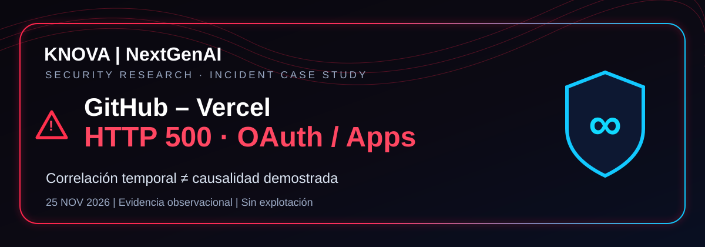

# GHV-001 · GitHub–Vercel — Error HTTP 500 durante integración

**Fecha observada:** 25/11/2026 · **Clasificación:** disponibilidad, autenticación e integración de plataformas · **Estado:** estudio documental; causa específica no confirmada

> **Advertencia:** esta investigación NO identifica una vulnerabilidad explotable ni atribuye a GitHub/Vercel una falla de seguridad confirmada. El banner es una ilustración original de un incidente observado, no una comunicación del proveedor.

## 1. Resumen ejecutivo

Durante la preparación del despliegue del frontend **Pulso Abierto V4** se observaron problemas al conectar su repositorio GitHub con Vercel. El navegador mostró una página de instalaciones de GitHub Apps que no finalizaba su carga y un error **HTTP 500** en un flujo de autenticación social de GitHub.

El proyecto funcionaba localmente y su push a GitHub se había completado. Esta observación limita el problema a **operaciones de autenticación/integración o infraestructura externa**; no permite determinar por sí sola cuál servicio interno falló.

En el seguimiento durante la sesión se contrastaron las capturas con informes públicos de estado de GitHub. La información disponible ofrece contexto, pero **no prueba que un incidente del proveedor haya producido este HTTP 500**.

## 2. Alcance y entorno

| Elemento | Registro |
|---|---|
| Aplicación legítima | [Pulso Abierto V4](https://github.com/romim127/pulso-abierto) |
| Stack | React, Vite, TypeScript, Zustand, Git |
| Hosting previsto | Vercel, importando repositorio GitHub |
| Rama/commit confirmado | `main` / `bfe2cf46110de0fc0ad519b1a73918c77ad7e969` |
| Cliente | Google Chrome sobre Windows |
| Pruebas sobre servicios de terceros | **Solo navegación legítima y observación pasiva** |

El trabajo no incluye escaneo activo, fuerza bruta, repetición automatizada de callbacks ni alteración de permisos de terceros.

## 3. Cronología observada

Horas de Argentina (UTC−03). Las marcas del navegador son aproximadas, obtenidas de capturas; se diferencian de cualquier registro de proveedor.

| Hora local | Evidencia observada |
|---|---|
| Antes de 13:00 | El repositorio de Pulso Abierto ya estaba publicado; GitHub respondía a operaciones Git. |
| ≈13:00 | Vercel solicitó instalar su GitHub App para importar `romim127/pulso-abierto`. |
| ≈13:13–13:15 | GitHub mostró problemas al cargar la página de instalaciones; se seleccionó acceso limitado al repositorio. |
| ≈13:19 | GitHub presentó error de servidor en una ruta de callback de autenticación social con Google. |

**Contexto externo:** durante la conversación se observó información cambiante acerca de incidentes de GitHub. Las instantáneas del estado público no constituyen trazas internas del error ni autorizan a adjudicar una causa raíz. Para cualquier actualización futura, citar la URL **específica e inmutable** del incidente y su publicación, en lugar de una lectura cambiante de la portada de estado.

## 4. Inventario de evidencias

| ID | Descripción | Estado |
|---|---|---|
| E-01 | Pantalla Vercel solicitando instalación de GitHub App | Captura original revisada; versión pública redactada pendiente |
| E-02 | Pantalla de permisos: selección exclusiva del repo | Captura original revisada; versión pública redactada pendiente |
| E-03 | Página de instalaciones de GitHub con error de carga | Captura original revisada; versión pública redactada pendiente |
| E-04 | Error 500 en ruta de callback OAuth | Captura original revisada; **URL original contiene parámetros sensibles**, no publicar |
| E-05 | Registro público del proveedor | Enlaces de consulta; confirmar incidente puntual antes de agregarlo como prueba |
| E-06 | Commit y estado del frontend | [Commit verificado](https://github.com/romim127/pulso-abierto/commit/bfe2cf46110de0fc0ad519b1a73918c77ad7e969) |

> **Importante:** los directorios de evidencias existen con instrucciones, pero **no contienen capturas sanitizadas ni logs reales**. No se fabrica evidencia.

## 5. Hipótesis y límites

| Hipótesis | Justificación | Confirmación |
|---|---|---|
| H1: degradación transitoria de un servicio GitHub | Fallos en distintas pantallas y operaciones; posible correlación temporal | **No confirmada para el callback concreto** |
| H2: error durante la sesión o intercambio OAuth | Ruta visible de callback e indicación HTTP 500 | **Mecanismo interno desconocido** |
| H3: fallo específico de instalación GitHub App / integración Vercel | Error al autorizar acceso al repositorio | **No aislado del resto de factores** |

Un **HTTP 500 no equivale automáticamente a una vulnerabilidad**. Tampoco existe evidencia que conecte este incidente con **CVE-2026-118764 (minimatch)**.

## 6. Método defensivo de investigación

1. Conservar originales en almacenamiento privado con fecha, origen y hash si procede.
2. Registrar un único intento normal en **Chrome DevTools → Network**, con `Preserve log` activado.
3. Observar host, método, ruta **sin query string**, estado HTTP, duración y mensaje de error.
4. Para Burp Suite Community, comenzar con un laboratorio propio/local. Si se utiliza con GitHub o Vercel, **solo observar** el tráfico generado por la cuenta propia: sin Intruder, Scanner, fuzzing, modificaciones de tokens ni reenvío de callbacks.
5. Eliminar de todo material publicable `code`, `state`, `iss`, cookies, encabezados `Authorization`, identificadores personales y cualquier otro dato de sesión. No publicar HAR bruto.
6. Comparar evidencia antes y después de una eventual normalización del servicio. Actualizar hipótesis, no atribuir causalidad automáticamente.

## 7. Resultado y próximos controles

- **Confirmado:** push correcto, código desplegable localmente, errores en vistas de GitHub relacionadas con instalación/autenticación.
- **No confirmado:** causa raíz del proveedor, relación causal específica con su estado público, existencia de vulnerabilidad explotable.
- **Pendiente:** anexar capturas *redactadas*, registros sanitizados y, si corresponde, URL pública de Vercel después del despliegue.

## 8. Fuentes

- [GitHub Status — historial y avisos](https://www.githubstatus.com/history)
- [GitHub Status — API pública](https://www.githubstatus.com/api)
- [Vercel Status](https://www.vercel-status.com/)
- [Repositorio Pulso Abierto](https://github.com/romim127/pulso-abierto)
- [Caso separado SCA-001 / minimatch](../npm-minimatch-CVE-2026-118764/README.md)

---

**KNOVA | NextGenAI — Security Research**

*AI assists. Human verifies. Human decides.*
